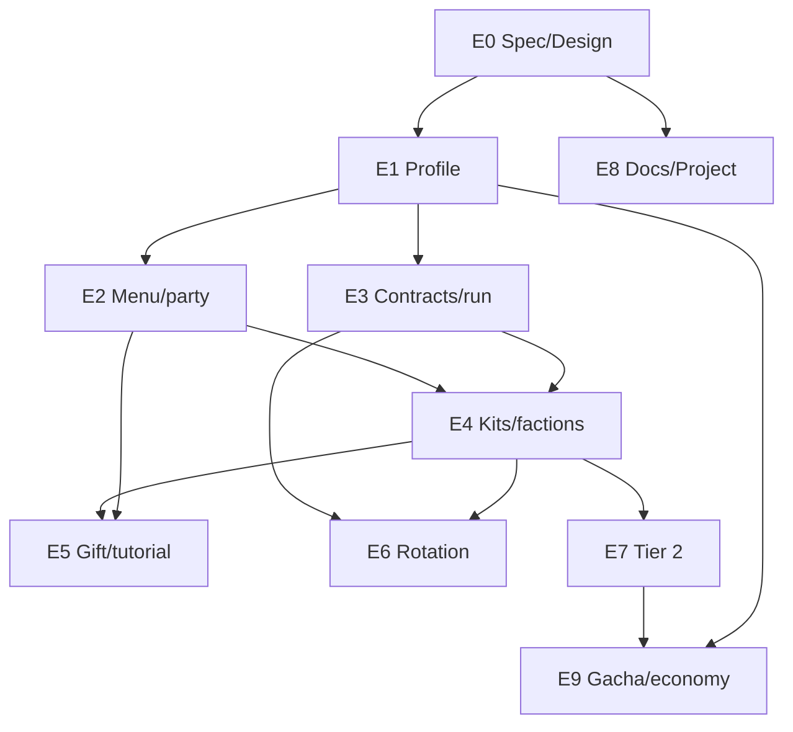

# Roadmap — Core Loop Meta (WaifuCafe)

> Estado: documentación inicial, 2026-10-28. Este documento es la fuente de verdad
> humana; el detalle SDD vive en Engram (`sdd/core-loop-meta/*`).
> Tablero vivo: https://github.com/users/luisplata/projects/10

## 1. Objetivo

Convertir el prototipo de tablero en un loop con propósito:

```
Gift 4 → Tutorial (menú → run scripted) → Recompensa 2 → Menú
      → Contrato + Party → Run → Resultado → Menú → ...
```

El tablero ya está validado. Lo que falta es el meta que le dé intención: perfil,
contratos, party, facciones, ultimates de facción, tutorial y recompensa.
El gacha real y la economía quedan para una fase posterior.

## 2. Decisiones confirmadas

| Decisión | Valor |
|---|---|
| Estrellas | **1–3**, nivel de **ascensión por jugador** (dupes). El asset no lockea estrellas. |
| Rareza vs poder | `rarity` = peso de drop; las estrellas actuales viven en `PlayerProfile` |
| Owned inicial (V1) | **6 curados, sin azar**: Airi 1★, Neko 2★, Luna 2★, Rika 3★, Hana 1★, Yuki 2★ |
| 3★ en V1 | **Solo Rika** (garantizada para el tutorial). El resto de 3★ llega con gacha/dupes. |
| Party | **4 slots** |
| Gacha real | **Locked** en V1; el starter gift es scripted y separado |
| Restaurantes | **1** (card); los demás locked. La decisión real es el contrato |
| Facciones V1 | **Café** y **Míticos** jugables; **Espectáculo** locked preview |
| Tutorial | `TutorialStep` enum en PlayerPrefs; guía **manager NPC no jugable** |
| Persistencia | `PlayerProfile` JSON en PlayerPrefs; `owned[].stars` |
| Menú | Escena nueva `Version4/MetaMenu` desde cero; el board sigue como run |
| Arquitectura | Composition root + prefabs + coordinadores; sin DI framework; sin TDD estricto |
| Roadmap | Este doc + Project #10; tarea fija E8 |

## 3. Facciones y roles

### Facciones (lore)

| Facción | Waifus | Identidad | Breakpoints |
|---|---|---|---|
| **Café** | Airi (Merchant), Neko (Catgirl), Yuki (Maid) | Economía | 2: +1 moneda/pedido · 3: +2 monedas y +10% carga |
| **Míticos** | Hana (Fox), Luna (Witch), Miko (Angel), Rika (Demon) | Skills/tablero | 2: -1 carga de skill · 3: -2 y +1 potencia · 4: empezar con 50% carga |
| **Espectáculo** | Alice (Princess), Emi (Idol), Sora (Idol) | Paciencia/combos | 2: +15% paciencia · 3: +30% y +1 moneda por combo |

### Roles (gameplay)

| Rol | Waifus | Breakpoints |
|---|---|---|
| **Cocina** | Hana, Miko | 2: +1 potencia de skill |
| **Servicio** | Luna, Neko, Emi | 2: +10% carga · 3: +20% carga |
| **Apoyo** | Airi, Alice, Sora | 2: +1 carga inicial · 3: +2 carga inicial |
| **Control** | Rika, Yuki | 2: -1 cooldown o +1 casilla afectada |

> Cambio de dato: **Yuki pasa de Apoyo a Control** (su activo es ReshuffleBoard).
> Así los cuatro roles tienen al menos un par. Cocina y Control solo llegan a 2
> porque tienen dos miembros.

## 4. Ultimates por facción (no por waifu)

La ultimate es de **facción**, no de una pareja fija. El líder puede ser
**cualquier** 3★ de la facción; la ultimate es la misma. La condición obliga a
comprometerse: mezclar 2+2 da breakpoints pero **no** ultimate.

| Facción | Ultimate T1 | Gate T1 | Efecto |
|---|---|---|---|
| **Café** | **Libro Mayor** | 3 Café + ≥1 de 3★ | El líder 3★ sirve 1 unidad de cada pedido o convierte 5 monedas en +3 carga. Café +1 moneda/pedido. |
| **Míticos** | **Luna de Sangre** | 3 Míticos + ≥1 de 3★ | El líder 3★ limpia 3×3 y convierte a Postre; +1 potencia. Míticos -1 carga. |
| **Espectáculo** | **Encore** | 3 Espectáculo + ≥1 de 3★ | El líder 3★ sirve +2 unidades de cada plato pedido. Espectáculo +15% paciencia. |
| **Míticos T2** | **Zorro de Fuego** | **4 Míticos + total ★≥8** (estrellas actuales) | El líder 3★ convierte 2 líneas a Bebida, +2 carga y +1 potencia. |

- El gate T1 es difícil al inicio (pocos 3★) y sencillo al final (dupes/gacha).
- **T2 corregido:** “4 Míticos + 2×3★” y “3 Míticos + total ≥8” son imposibles con
  el roster V1; el gate real es **4 Míticos + total ★≥8**. Es una meta de
  progresión, alcanzable con dupes.
- V1 implementa **Libro Mayor** y **Luna de Sangre**, pero en la partida V1 solo
  se juega **Luna de Sangre** (Rika 3★). Libro Mayor, Encore y Zorro de Fuego
  quedan como chase y se prueban con debug.
- El nivel de skill in-run (1–3, 6/12 unidades del elemento) escala potencia; no
  cambia la identidad de la ultimate.

## 5. Contratos (motor de rotación)

Cada run tiene un **contrato** con objetivo, modificadores y derrota propios.
El contrato se elige en el menú y rota entre runs. No hay un objetivo genérico
de monedas/pedidos.

| Contrato | Facción | Objetivo específico | Modificadores | Derrota |
|---|---|---|---|---|
| **Rush de Mediodía** | Café | Servir 18 pedidos en 180 s | Llegadas +15%, monedas +50% | 3 clientes perdidos o tiempo sin llegar a 18 |
| **Noche de Brujas** | Míticos | Lanzar 6 skills y limpiar 25 Postre | Carga +20%, peso de Postre +50% | 3 perdidos o tiempo sin cumplir |
| **Hora del Té** (locked preview) | Espectáculo | Servir 6 VIP sin perder ninguno | Paciencia VIP -25%, combos +1 moneda | 1 VIP perdido o tiempo sin llegar a 6 |
| **Desayuno Real** (later) | Mixto | Servir 10 Desayunos y 10 Postres | Sin ultimate; breakpoints 2/2 | 3 perdidos o tiempo sin cumplir |

- V1: **Rush** y **Noche** jugables + **Hora del Té** locked preview.
- La rotación es la razón para cambiar de facción/party. Sin contratos, la build
  óptima se congela.
- La derrota y la victoria son **por contrato**, no por un marcador único.
- Soft fail: monedas parciales; el resultado muestra el objetivo y el progreso.

## 6. Roster inicial (V1)

| Waifu | Facción | Rol | ★ | Origen |
|---|---|---|---|---|
| Airi | Café | Apoyo | 1★ | Gift |
| Neko | Café | Servicio | 2★ | Gift |
| Luna | Míticos | Servicio | 2★ | Gift |
| Rika | Míticos | Control | 3★ | Gift |
| Hana | Míticos | Cocina | 1★ | Recompensa tutorial |
| Yuki | Café | Control | 2★ | Recompensa tutorial |

- **V1 es curado, sin azar**: 3 garantizadas (Airi 1★, Neko 2★, Rika 3★) + 1
  táctica (Luna 2★) + 2 de tutorial (Hana 1★, Yuki 2★). **Solo Rika es 3★.**
- **Café 3** (Airi/Neko/Yuki 2★) y **Míticos 3** (Hana/Luna/Rika 3★): la ultimate
  Mítica (**Luna de Sangre**) se juega; **Libro Mayor** queda como chase hasta
  conseguir un 3★ Café (gacha/dupes).
- Locked para el gacha: **Alice** (Espectáculo/Apoyo), **Emi**
  (Espectáculo/Servicio), **Sora** (Espectáculo/Apoyo), **Miko** (Míticos/Cocina,
  necesario para el T2 Mítico). **Sin estrellas fijas**: las actuales viven en el
  perfil y se suben con dupes.
- 10 waifus con stars 1–3 por jugador; **6 kits jugables** en V1, **4 data-ready**
  para el gacha. La 3★ del starter es una decisión de prototipo (Rika); el sistema
  debe quedar data-driven para que en el futuro salga cualquier 3★ y el tutorial
  se adapte.

## 7. Run, victoria y derrota

- Duración base: 180 s (el contrato puede ajustar).
- Victoria: cumplir el objetivo del contrato.
- Derrota: condición del contrato (3 perdidos, 1 VIP, tiempo sin objetivo).
- Soft fail: monedas parciales; nunca castigo duro.
- Resultado: objetivo, progreso, monedas, ultimate usada, botón “volver al menú”.
- Las monedas se guardan aunque el gacha esté locked.

## 8. Tutorial

| Paso | Contenido |
|---|---|
| 0. Gift | Tirada scripted curada en V1: Airi 1★, Neko 2★, Luna 2★, Rika 3★. Cinemática por tier (1★/2★/3★), reutilizada por waifu. |
| 1. Menú | Tour con el **manager NPC no jugable** como guía: contratos, party, gacha locked, restaurante. |
| 2. Run tutorial | Mismo `Prototype_Board` con `RunConfig` (seed, pedidos scripted, sin derrota). Enseña swap, match, carga y skill. |
| 3. Recompensa | Hana 1★ + Yuki 2★ → 6 owned. Se explica **Luna de Sangre** (Rika 3★); Libro Mayor/Encore/T2 quedan como chase. |
| 4. Done | `TutorialStep = Done`; no se repite. Reset manual desde el perfil. |

- **Guía no jugable**: el manager NPC explica; ninguna waifu depende de otra ni
  hace de guía. Airi sigue siendo playable (Café/Apoyo).
- **StarterConfig data-driven**: en V1 se curan los 6; en V2 debería poder salir
  cualquier 3★ y el tutorial adaptarse. La V1 no construye los 10 tutoriales
  alternativos.
- No se copia la escena: se reutiliza el tablero con configuración.
- El tutorial debe terminar en victoria; la derrota se enseña en la primera run
  libre.

## 9. Kits

- 6 kits jugables en V1: Airi, Neko, Luna, Rika, Hana, Yuki.
- 4 kits data-ready: Alice, Emi, Sora, Miko.
- Cada waifu: **activo + pasivo**. Base actual: `SkillArchetype`
  (ClearCross, ConvertToElement, InstantServeUnits, ReshuffleBoard) y
  `PassiveId` (ExtraCharge, CoinBonus, FasterService). La tabla exacta
  activo/pasivo por waifu se cierra en `sdd-design`.
- Regla: el activo toca tablero, reloj o targeting; no solo porcentajes.
- La ultimate de facción reemplaza el activo del líder 3★ cuando se cumple el
  gate.

## 9.1 Arquitectura y escena V1

- **Menú nuevo desde cero**: `Assets/Scenes/Version4/MetaMenu.unity` con Canvas +
  TMP, reutilizando arte (cartas, chibis, fondo, manager). No se reusa la lógica de
  `MainMenu` ni `WaifuSelector`; solo el arte. `Prototype_Board` sigue como escena
  de run. `Prototype_Match3` sale del build.
- **Guía**: `GuideSO`/`GuidePanel` con el manager NPC no jugable y su arte.
  Ninguna waifu depende de otra; las ultimates son por facción.
- **Composition root + prefabs**:
  - `GameRoot` persistente: `IProfileStore`, `IWaifuCatalog`, `IContractCatalog`,
    `IRunSession`, `ITutorialFlow`.
  - `MetaCoordinator` (menú), `RunCoordinator` (board),
    `TutorialCoordinator`/`GiftCoordinator`.
  - Cada coordinador posee sus prefabs y referencias serializadas;
    `Initialize(...)` explícito; **sin `FindFirstObjectByType`**.
  - `SkillExecutor`/`CafeFloor`/`BoardSession`/`WaifuPartyView` se configuran desde
    `RunCoordinator` antes de arrancar.
- **Sin DI framework** en V1: composition root manual. **VContainer** queda como
  opción si el grafo crece. UI con uGUI Canvas + TMP; UI Toolkit es opcional.
- **Sin TDD estricto**: estamos prototipando. Modelos puros en `V2/Core/Meta` para
  testear barato; tests mínimos de perfil/contrato/gates si suman.
- **Estrellas**: `owned[].stars` en el perfil; el asset solo `baseStars`/`maxStars`
  y `rarity` como peso de drop.

## 10. Epics y dependencias

| Epic | Phase | Depende de | Size | Alcance |
|---|---|---|---|---|
| **E0 Spec/Design** | 0 Spec/Design | — | M | Cerrar proposal/spec/design; tablas de kits y contratos; roadmap. |
| **E1 Profile/save** | 1 Profile | E0 | M | `PlayerProfile` JSON, `owned[].stars`, party/coins/contract/tutorialStep; reset. |
| **E2 Menu/party UI** | 2 Menu | E1 | L | Menú nuevo `Version4/MetaMenu` desde cero, composition root, prefabs/coordinadores, contratos, party 6/4, gacha/restaurante locked. |
| **E3 Contratos/run/result** | 3 Contracts | E1 | L | `ContractSO`, `RunConfig`, win/lose por contrato, resultado, monedas. |
| **E4 Kits/facciones/ultimates** | 4 Kits | E1, E2, E3 | L | 6 kits, breakpoints, Libro Mayor/Luna de Sangre; V1 live Luna de Sangre (Rika 3★); Libro Mayor debug/chase. |
| **E5 Gift/tutorial** | 5 Tutorial | E2, E3, E4 | L | 6 owned curados (Airi1/Neko2/Luna2/Rika3/Hana1/Yuki2), guía manager NPC, tutorial state machine, `StarterConfig` data-driven. |
| **E6 Rotación/Espectáculo preview** | 6 Rotation | E3, E4 | M | Rotación de contratos; Hora del Té locked. |
| **E7 T2/Espectáculo ultimate** | 7 Tier 2 | E4 (4 kits data-ready) | L | Implementar los 4 kits restantes, Zorro de Fuego (4 Míticos + total ★≥8) y Encore; debug ownership. |
| **E8 Roadmap docs/Project** | 8 Docs | E0, ongoing | S | Doc + Project #10 actualizados; tarea fija. |
| **E9 Gacha/economía/dupes/4–5★** | 9 Gacha | E1, E4, E7 | XL | Gacha real, monedas, dupes/ascensión (estrellas), 4–5★ y adquisición de Alice/Emi/Sora/Miko. |



- **Camino crítico:** E0 → E1 → E3 → E4 → E5. E2 en paralelo con E3.
- **V1 (primer slice):** E1–E5 + E8. Rika 3★ curada: **Luna de Sangre live**;
  Libro Mayor, Encore y Zorro de Fuego son chase/debug.
- **V1.1:** E6–E7.
- **V2:** E9 (gacha, dupes, estrellas, roster completo).

## 11. GitHub Project #10

- Tablero: https://github.com/users/luisplata/projects/10
- Campos: `Status` (Todo/In Progress/Done), `Phase` (0–9), `Depends on` (texto),
  `Size` (S/M/L/XL).
- Vista recomendada: **Table agrupada por Phase** para el orden de dependencias;
  **Board por Status** para el día a día.
- Issues: E0–E9 con labels `epic` y `core-loop-meta`, milestone
  `Core Loop v1` / `v1.1` / `v2`.
- El token de `gh` necesita `gh auth refresh -s project` para escribir en el
  Project (ya validado en esta sesión).

## 12. Fuera de alcance (V1)

- Gacha real, economía de compra, dupes/ascensión.
- 4–5 estrellas.
- Más restaurantes, 100 waifus, skins, backend.
- Implementación de Encore/Zorro de Fuego y de los 4 kits restantes.
- Tutorial adaptativo por cualquier 3★ random (V1 cura Rika; la adaptación
  completa es V2).
- Rehacer el gameplay/board desde cero: se reusa `Prototype_Board`; la escena
  nueva es el menú.

## 13. Riesgos y preguntas abiertas

| Riesgo | Mitigación |
|---|---|
| Scope explosion (6 kits + menú + tutorial + contratos) | Epics con dependencias; V1 solo Café/Míticos; E6–E9 después. |
| Contratos mal tuneados / ilegibles | 2 contratos en V1, números en `sdd-design`, instrumentar win/lose. |
| Ultimate poco clara | Panel de party con gate 3/3 + 1★3 y tooltip; el líder se ve. |
| Tutorial frágil | `RunConfig` con seed/pedidos scripted; misma escena; guía manager. |
| Legacy V2 | Nuevo `PlayerProfile`; no tocar `SaveGame`/`SaveManager`/`TutorialProgress`. |
| V1 solo juega Luna de Sangre | Rika 3★ curada; Libro Mayor/Encore/T2 se muestran como chase y se prueban con debug. |
| Estrellas fijas en el asset | `owned[].stars` en el perfil; `rarity` solo peso de drop; nunca lockear el poder. |
| Menú/coordinadores acoplados | `GameRoot` + `MetaCoordinator`/`RunCoordinator` + prefabs con refs; `Initialize(...)`; sin `FindFirstObjectByType`. |
| Project desactualizado | E8 es tarea fija; cada epic cierra con doc + Project al día. |

Preguntas a cerrar en `sdd-design`:

1. Números exactos de contratos, breakpoints y ultimates.
2. Matriz activo/pasivo de los 10 kits.
3. UI del panel de sinergias, party y resultado.
4. `StarterConfig`/`GuideSO`: textos, arte del manager y cómo se reemplaza Rika
   por cualquier 3★ en V2.
5. `owned[].stars`/dupes: base, máximo y UX de ascensión.

## 14. Referencias Engram

- `sdd/core-loop-meta/proposal` (#3143)
- `sdd/core-loop-meta/synergy-design` (#3144)
- `sdd/core-loop-meta/explore` (#3147)
- `sdd/core-loop-v2/proposal` (openspec, gameplay anterior)
- `sdd/core-loop-meta/roadmap` (este documento, resumen)

## 15. Tarea fija E8

Ningún epic se considera cerrado sin:

- [ ] Actualizar `docs/roadmap-core-loop.md` si cambió alcance/decisión.
- [ ] Actualizar el Project #10 (Status, Phase, Depends on, Size).
- [ ] Dejar el issue con acceptance y links a los artefactos SDD.

Esta tarea es continua y no se “cierra” hasta el final del Core Loop Meta.
